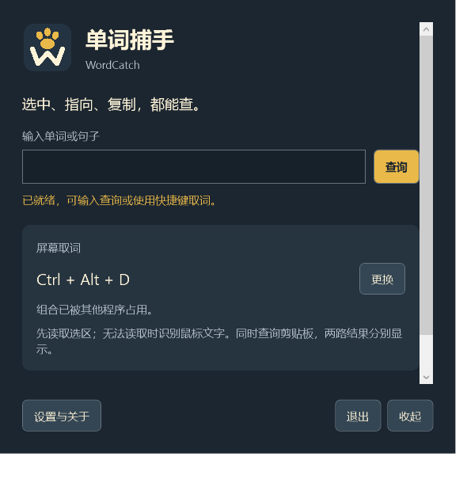

# 单词捕手 · WordCatch

Windows 10/11 x64 取词助手。按 **Ctrl + Alt + D**，优先读取当前软件选中的文字；没有可读取的选区时，再识别鼠标位置的单词。同时读取剪贴板文字，两路结果在同一窗口分别显示。

<a id="新版体验"></a>

## 主要功能

- **Ctrl + Shift + Alt + D** 框选屏幕区域，识别多行文字；启用云端后翻译整段。Esc 或右键取消。
- 支持本机个人短语库，优先整体识别多词名称；个人数据库不随安装包分发。
- 可选开机自启动，默认关闭；开启后登录 Windows 时进入通知区域。

- 猫爪与 W 平面图标，主窗口、托盘和安装器统一识别。
- 主窗口集中查询输入和快捷键；词库详情移到设置。
- 词卡保留「选中文字／屏幕识别／剪贴板」来源，区分单词释义与句子译文。
- 完整词未收录时，自动按连字符、下划线或驼峰边界拆分，逐项显示本地释义。
- 云端显示等待状态；新查询或修改原文会取消旧请求，旧结果不会覆盖当前内容。
- 安装升级将本程序旧名称快捷方式替换为「单词捕手」，保留旧版配置。



<a id="安装使用"></a>

## 安装与使用

当前版本 **v0.6.0**：[安装程序](https://github.com/tianqistudio/wordcatch/releases/tag/v0.6.0)（约 166 MiB）。内置运行环境、OCR 模型和词典，无需另装 Python 或 .NET。

1. 安装时可独立选择桌面和开始菜单快捷方式，默认均勾选。
2. 启动后等待就绪。选中文字或把鼠标放在单词上，按快捷键查询。
3. 优先显示本地释义。可编辑原文重查，也可手动请求云端翻译。
4. 在「设置与关于」填写 Azure Translator 密钥及资源区域，启用备用翻译并测试连接。默认关闭，不含共享密钥。
5. 主窗口关闭后收起到通知区域，选择「退出」结束程序。快捷键冲突时可更换组合。

详见 [使用说明](docs/installed-guide.md)。本机开发启动使用 `Start-WordLens.ps1 -Development`，不执行安装。

## 本地词库与云端

- 770,611 条词典记录，其中 768,739 条有中文释义；含短语、专名和不同拼写，并非全部是独立英文单词。
- 仅含英文字母的词条 365,948 条；允许连字符和撇号后为 400,183 条。另有 58,313 条词形变化映射。
- 本地提供词典释义，不提供离线整句机器翻译。Azure 支持单词和短句，单次最多 2,000 字符。
- OCR 和词典在本地运行。云端仅接收查询文字，不上传截图；密钥通过 Windows 当前用户加密保护，费用取决于自己的 Azure 资源。
- 不保存查询历史，不后台监听剪贴板；仅在快捷键查询时读取文字，只有点击「复制原文」才写入剪贴板。配置位于 %LOCALAPPDATA%\TianqiStudio\WordLens。

## 自动检测更新

在「设置与关于」选择 **自动 / tianqistudio.com / GitHub**。默认自动检查，每 6 小时最多一次，也可关闭或手动检查。双源自动比较版本，单源失败时使用另一源。仅请求公开版本信息，不上传查词内容；发现新版后提示打开发布页，不自动下载安装。

网站清单：[latest.json](https://tianqistudio.com/updates/wordcatch/latest.json)。网站提供检测信息，安装包由 GitHub Releases 托管，不代表两处都有安装包镜像。

<a id="开发"></a>

## 开发与测试

C# / WPF、Windows UI Automation、RapidOCR + ONNX Runtime CPU、ECDICT SQLite。快捷键复用 DesktopShortcuts。来源和许可见 [第三方说明](docs/third-party.md)。

新开发环境需要 Python 3.12 和 .NET 10 SDK。在项目根目录准备环境：

```powershell
.\Setup-WordLens.ps1
```

Python 回归测试：

```powershell
.\.venv\Scripts\python.exe -m unittest discover -s tests -v
```

<a id="使用说明"></a>

## 使用边界

选区读取依赖目标软件的 UI Automation 支持；不支持或超时时回退 OCR。复杂背景、小字体、动态画面及受保护窗口可能失败。没有自动悬停、发音或自动安装更新。开机自启动默认关闭，可在设置中开启。

## 品牌与兼容

可编辑图标在 [wordcatch.svg](src/WordLens/Assets/wordcatch.svg)，PNG 和多尺寸 ICO 同目录。为兼容旧版本，内部命名空间、程序文件名及安装／配置标识仍保留 WordLens。

<a id="源码与版权"></a>

## 许可与版权

源码公开供查看，版权与第三方许可见 [NOTICE.md](NOTICE.md)。

由 [tianqistudio](https://tianqistudio.com/home) 制作。
